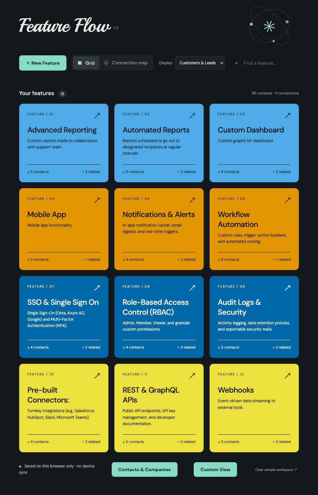
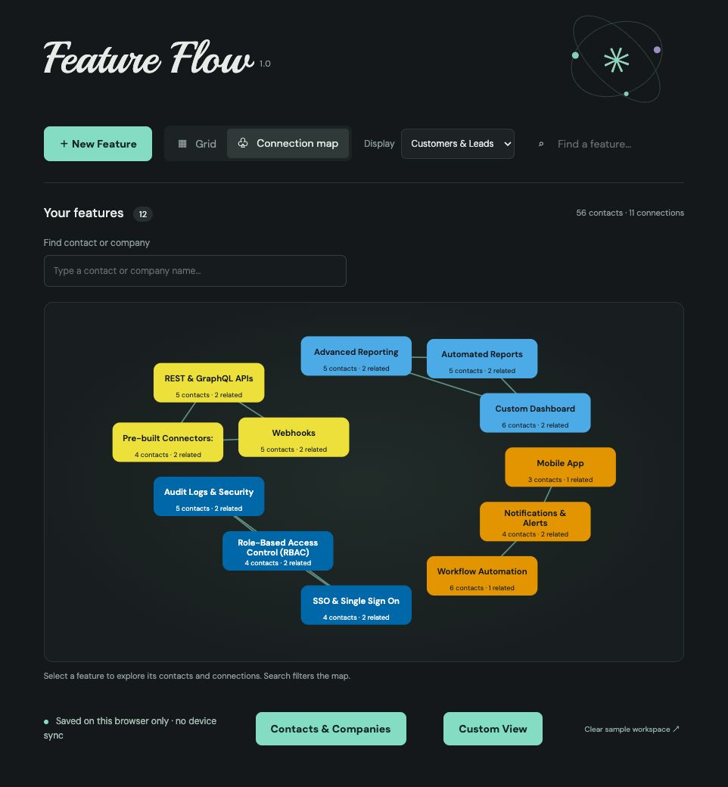

# Feature Flow 1.0

A desktop-browser workspace for SaaS sales and account managers to connect customer and lead interest with product features.

## The business problem

Feature requests and expansion signals often sit in separate notes and conversations. Feature Flow organizes them around product capabilities, making it easier to find interested accounts, see related opportunities, and prepare targeted follow-ups.

Product direction and account-management workflows by Paul Edworthy. Built with AI assistance.

## Try it online

Open [Feature Flow](https://pauledworthy-stack.github.io/feature-flow/) in a desktop browser. No account or installation required. Records stay in your browser. Use **Backup & Restore** to download or restore a full workspace.

## Start locally

Requirements: Python 3 and a modern desktop browser. No package installation or build is needed.

1. Download and unzip the release.
2. Open a terminal in the extracted Feature-Flow folder.
3. Run `python3 -m http.server 8765 --bind 127.0.0.1`.
4. Open http://127.0.0.1:8765/.

Use the same address and port each time to access the same saved workspace. Stop the server with Ctrl+C.

New browser workspaces start blank. Select **Explore a sample workspace** for fictional demo records; **Clear sample workspace** removes those sample tiles while keeping user-created feature tiles.

## What v1.0 includes

- Seven colour choices from the Okabe–Ito palette, with numbered swatches and contrasting text.
- Drag-to-reorder feature tiles; Alt + arrow keys provide a keyboard alternative.
- Related-feature links and an interactive map that focuses and spreads highlighted clusters.
- Selectable contact/company suggestions in map search.
- Customer/lead filtering across contact lists and counts.
- Feature editing sessions: **Save Changes** commits the session; closing with unsaved changes offers Save, Discard or Keep editing.
- Collapsible, searchable contact lists and saved-contact suggestions.
- Contact editing and lead conversion across matching feature associations.
- Contacts & Companies directory with mini feature tiles, creation, multi-feature assignments, deletion confirmations, affiliation removal and immediate Undo while the directory stays open.
- CSV import with per-row feature assignments and a staged preview.
- Custom View by features, contact, company and contact type; results group matching people into one row.
- CSV export of the generated custom list.

## Import and export

See [CSV-GUIDE.md](CSV-GUIDE.md). The same instructions are available through **Contacts & Companies → Add contact / company → instructions**.

## Storage and privacy

This is a local browser application, not an installed desktop app. Workspace records live in localStorage for the exact browser, profile and site address used. There is no login, cloud database or cross-device sync. Clearing site data, changing browsers or changing the server address can make saved data unavailable.

Use **Backup & Restore → Download full backup** to save a JSON copy of the whole workspace, including feature order, colours, contacts and relationships. Restore validates the file and explicitly confirms replacement of the current workspace. Keep backups safe; they contain contact information. CSV exports preserve contact lists only, not the complete workspace. Google Fonts is requested for typography; system fonts are used if unavailable. The app does not send contact records to a server.

## Contact identity

Matching prioritizes case-insensitive email. Different nonempty emails remain distinct. Without emails, matching name/company or name/phone can associate records. This is a heuristic: identical names at the same company without email may be conflated. Prefer email for reliable matching. Suggestions reduce typing errors but do not guarantee deduplication.

A company-only entry is stored as a contact-style record associated with features. This version has no independent, unassigned master company/contact database.

## Design and accessibility

Feature names and Customer/Lead labels carry meaning independently of colour. Each tile text/background pair measures at least 4.5:1 contrast. The palette does not guarantee universal colour distinguishability. Native controls, labelled fields, keyboard focus styles and reduced-motion rules are included. Desktop browser use is the v1 target; a narrow viewport was checked, but physical mobile touch and full cross-browser testing remain outstanding.

## Release validation

See [QA-REPORT.md](QA-REPORT.md) for tested workflows and limits. Import → assigned features → custom list → export → reimport was tested with quoted CSV values, duplicate protection and unknown-feature rejection.

## Future directions

An installed desktop app with dedicated local storage, a central contact model, and optional sync. These are roadmap ideas, not v1.0 features.

## Project layout

- `index.html`, `style.css`, `app.js`: complete application; no build step.
- `grid.png`, `map.png`: current interface screenshots.
- `CSV-GUIDE.md`, `QA-REPORT.md`, `CHANGELOG.md`: release documentation.

Fonts: DM Sans and Playball via Google Fonts. Palette: [Okabe and Ito, Color Universal Design](https://jfly.uni-koeln.de/color/).
